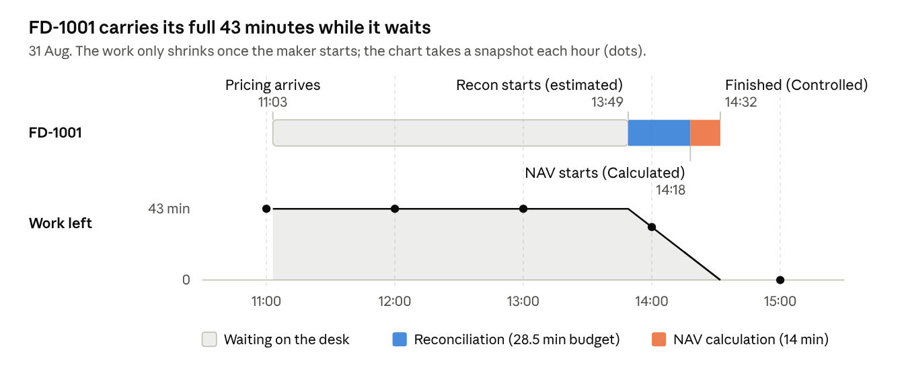
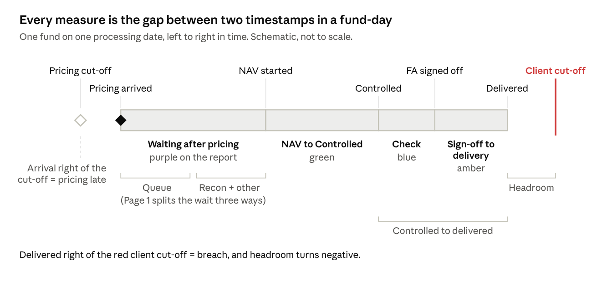

# NAV Bottleneck Report — Chart Guide

Oct 7, 2026 · Jiakee Lee

> Snapshot of the live Claude Doc (https://claude.ai/code/artifact/8e25fe1c-da92-496c-bf71-de0d4d1ade1b), exported 21 Oct 2026. The doc is the master copy; this file does not update when the doc changes.

## How to use this guide

The report has two pages that answer two questions: Page 1 asks **where supplier risk sits and what delays the funds**; Page 2 asks **when each fund's NAV started, got controlled and got delivered** on one day. Each chart below has the same six parts, and the last part is a one-line text you can paste into the page's "How to read this page" box.

|  | Page 1 — Supplier Concentration Risk | Page 2 — Fund Level |
| --- | --- | --- |
| Question | Which pricing groups expose the most funds, and is lateness coming from suppliers or from inside the team? | For one client on one date, where did each fund's time go? |
| Typical user | Team lead, supplier manager, ops management | Analyst, team lead reviewing a specific day |
| Filters | Date range, client | Single date, single client, fund |
| Unit | Fund-days across a period | Individual funds on one day |

**Where the numbers come from.** Everything is built from the Excel template v4.5. Pricing arrivals come from Fact\_Milestone (one row per pricing group per day). Status times come from Status\_Log (Calculated, Controlled, FA signed off, signed off). Cut-offs and fund attributes come from Dim\_Fund. Nothing is typed into Power BI by hand.

**Colour code used on both pages.**

- Purple — waiting after pricing arrived (on Page 1, specifically waiting behind other funds)
- Amber — on Page 1, wait not explained by queue or recon (other hold-up); on Page 2, FA signed off to delivered
- Green — FA's own NAV work, NAV start to Controlled
- Blue — on Page 1, the maker reconciling this fund (own recon); on Page 2, Controlled to FA signed off (the check)
- Red — breaches, late pricing, the client cut-off line

**One rule for everyone.** A fund-day is one fund on one processing date. Most totals on Page 1 are counts of fund-days, not counts of funds.

## Page 1 — the five headline cards

The five cards answer, in order: who is our biggest single point of failure, how often do suppliers miss, how often do we miss, how much of our miss is the supplier's, and how much of our waiting is avoidable. Use the date slicer for the period and the client slicer to narrow to one client.

| Card | What it answers | How it is calculated | How to read it |
| --- | --- | --- | --- |
| **Largest TOP** (e.g. TOP-04, 21% of funds, 5 clients) | Which single pricing file, if late, hits the most funds? | The pricing group (TOP) with the most funds assigned. Share = its funds ÷ all funds in view. Clients = distinct clients among those funds. | A high share across many clients is concentration risk: one late file becomes a multi-client incident. |
| **TOP late rate** (e.g. 12%) | How often does the pricing supplier miss? | Late TOP-days ÷ scored TOP-days. A TOP-day is late when the file arrives after the **binding cut-off**: the earliest pricing cut-off among that group's funds that actually ran that day. | This is the supplier conversation. Only days on which a fund in view depended on the file are counted. |
| **Breached fund-days** (e.g. 175, 9.7% of 1,800) | How often do we deliver after the client cut-off? | Fund-days where Delivered is later than the client cut-off. Subtitle = breached ÷ all fund-days. | This is our service result to clients, whatever the cause. |
| **Breaches, pricing late** (e.g. 53%) | How much of our breach problem starts with late pricing? | Breached fund-days where pricing arrived after **that fund's own** pricing cut-off ÷ all breached fund-days. | High = the fix sits mostly with the pricing supplier. Low = most breaches start after pricing arrived, inside our process. |
| **Share of wait behind other funds** (e.g. 5%) | After pricing arrived, how much of the wait was the maker still busy on other funds? | Queue minutes ÷ total wait after pricing. The wait splits three ways: queue (the same maker working on another fund), own recon (the same maker reconciling this fund, up to its recon budget) and other hold-up (the rest). Two more measures give the other two shares; the three add to 100%. | High = a capacity or sequencing problem. Low, with a high other-hold-up share = data or breaks are holding funds, not workload. |

**Watch-outs.**

- TOP late rate and Breaches, pricing late use different cut-offs on purpose. The first measures the supplier against the group's earliest deadline; the second measures each fund against its own. They will not agree, and both are correct.
- The wait split is reconstructed, not observed. Queue and own recon both use recon budgets as each fund's work window, not actual work times, and only work in the status log is visible.
- Largest TOP is a design view. It counts funds assigned, so it does not change with the date slicer.

## Page 1 — the five charts

Read the page left to right: who is exposed, how much protection each supplier type gives, which pricing groups actually cause damage, where the waiting happens, and what sits behind each client's breaches.

### 1. Who is exposed — funds behind each TOP

- **Question:** which pricing files carry the most funds and clients?
- **What you see:** one bar per pricing group (TOP), longest first. The label reads "19 funds · 5 clients". The largest TOP is red; the rest are grey.
- **Calculation:** funds assigned to each TOP in Dim\_Fund, and the distinct clients among them. Responds to the client slicer, not the date slicer.
- **How to read it:** the longer and more multi-client the bar, the bigger the blast radius of one late file. A TOP serving five clients is five client conversations on a bad day.
- **What to do with it:** use it to prioritise which pricing SLAs to monitor and escalate first.
- **Textbox line:** *Exposure: many funds on one pricing file means one late file reaches many clients.*

### 2. Dependency types — and how much slack protects them

- **Question:** for each kind of upstream feed, how many funds depend on it and how much buffer is there before it hits NAV?
- **What you see:** a table with four rows (Pricing, Custody, TA, Broker) and columns for funds, clients, median slack and thin-slack funds.
- **Calculation:** slack = the fund's pricing cut-off minus that feed's cut-off. Median slack is across the funds that have the feed. A fund is **thin** when slack is 0 minutes or less (Constants B17, zero tolerance). Pricing always shows 0 min and "all funds", because pricing *is* the gate.
- **How to read it:** pricing is the only feed with no buffer, so a late pricing file goes straight into NAV. Custody and TA usually have hours of slack; their lateness is absorbed. Amber numbers in the thin column are funds where that feed has no buffer either.
- **What to do with it:** thin-slack funds are the only ones where custody, TA or broker lateness could matter. Review their cut-offs before chasing those suppliers.
- **Textbox line:** *Pricing has no slack: a late file reaches the funds directly. Custody, TA and broker are absorbed unless slack is thin.*

### 3. Pricing delay — created vs reached

- **Question:** which pricing groups' lateness actually turned into client breaches?
- **What you see:** two bar charts side by side, one row per TOP. Left: total hours the file was late in the period (**created**). Right: breached fund-days on those late days (**reached the funds**).
- **Calculation:** left = sum of minutes late against the binding cut-off ÷ 60. Right = breached fund-days of that TOP on days its file was late.
- **How to read it:** a long left bar with a short right bar means the team absorbed the delay. Long on both means the delay went through to clients. Short left but long right is unusual and suggests the funds were already at risk.
- **What to do with it:** escalate the TOPs where both bars are long; those are the supplier issues with client impact.
- **Textbox line:** *Created vs reached: a late file only matters if the right-hand bar follows.*

### 4. Where funds waited after pricing arrived

- **Question:** once pricing landed, why did funds still wait to start?
- **What you see:** a stacked bar for four groups of fund-days, with average minutes per fund-day. Purple = behind the maker's other funds (queue). Blue = the same maker reconciling this fund (own recon). Amber = any other hold-up. The n= label shows how many fund-days are in each group.
- **Groups:** broker-dependent vs not broker-dependent; thin vs ample custody slack. The groups overlap: each fund-day sits in one broker group and one custody group.
- **Calculation:** total wait = NAV started minus pricing arrived. Queue = minutes between pricing arrival and NAV start when the same maker was working on another fund that day, i.e. inside that fund's work window (its recon budget before its Calculated time). A hold-up on the fund ahead is not passed down. Own recon = this fund's recon budget, capped at what is left after the queue. Other hold-up = total wait minus queue minus own recon. Nothing is called idle: the same maker usually does both recon and calculation.
- **How to read it:** mostly purple means the bottleneck is capacity or the order work is picked up. Blue is expected work. Mostly amber means the fund was held beyond its recon budget: data not ready, breaks, or recon running over. Compare groups: if broker-dependent funds carry much more amber, broker data is the likely holdup.
- **What to do with it:** purple → look at workload, sequencing and reassignment. Amber → look at recon breaks, data readiness, and whether recon budgets are realistic.
- **Textbox line:** *Waiting: purple is queueing behind other funds, blue is the maker reconciling this fund, amber is any other hold-up such as data or breaks.*

### 5. Breached fund-days by possible cause

- **Question:** for each client, what sits behind their breaches?
- **What you see:** a stacked column per client, total height = breached fund-days, split into four colours: Pricing late (red), Thin custody slack (blue), Broker-dependent (purple), None of these (grey).
- **Calculation:** each breached fund-day gets one label, first match wins in this order: pricing arrived after the fund's own cut-off → Pricing late; else the fund has thin custody slack → Thin custody slack; else it depends on a broker → Broker-dependent; else None of these.
- **How to read it:** only red is a measured cause. Blue and purple are possibilities: the fund was exposed to that feed, but we do not capture custody, TA or broker arrival times, so we cannot prove they were late. Grey means none of the known exposures applied, so the cause is most likely inside our own process.
- **What to do with it:** red-heavy clients → supplier conversation. Grey-heavy clients → look at Page 2 for that client to see where the time went.
- **Textbox line:** *Only pricing can be called a cause; the others are possibilities.*

## Page 2 — Fund Level

Page 2 zooms in on one client on one date and shows each fund's day as a timeline. Pick a single date and a single client first; the fund slicer is optional. Use it after Page 1 points you at a client, or to review a bad day.

### The five headline cards

| Card | What it answers | How it is calculated | How to read it |
| --- | --- | --- | --- |
| **Funds in view** (e.g. 24 — 4 breached, 3 client sign-off) | How many funds ran, how many missed, how many use the client sign-off model? | Distinct funds in the filtered fund-days; breached = delivered after client cut-off; client sign-off = Signoff\_Model is Client. | Sets the scale for the rest of the page. |
| **Waiting after pricing** (e.g. 37 min) | How long did funds sit after pricing arrived before NAV started? | Average of NAV started minus pricing arrived; 0 if NAV started before pricing arrived. | Large numbers point to queueing or recon holding the start. |
| **NAV to Controlled** (e.g. 22 min) | How long did FA's own NAV work take? | Average of NAV started to Controlled. For client sign-off funds, NAV started to FA signed off, because they have no Controlled step. | This is the team's processing time. |
| **Controlled to delivered** (e.g. 15 min) | How long from FA finishing to the client receiving it? | Average of NAV end (Controlled, or FA signed off for client sign-off funds) to Delivered. | Covers the check and any external sign-off tail. |
| **Headroom to cut-off** (e.g. 45 min) | On average, how early were we? | Average of client cut-off minus Delivered. Negative = delivered late. | An average can hide individual breaches; always check the timeline. |

### NAV timeline by fund

- **Question:** for each fund on this day, where did the time go, and did it cross the client cut-off?
- **What you see:** one row per fund, sorted by NAV start (earliest at the top). Each row is a bar on a fixed 02:00–16:00 clock:
  - **Purple:** waiting after pricing arrived, from pricing arrival to NAV start.
  - **Green:** NAV calculation to Controlled (FA's own work).
  - **Blue:** Controlled to FA signed off (the check).
  - **Amber:** FA signed off to delivered.
  - **Cut-offs:** short vertical lines: teal = custody, magenta = broker, dark grey = pricing, red = client. **Filled diamond:** when pricing arrived.
  - **Tooltip:** hover a bar for the client name and every cut-off time (n/a where the fund has no custody or broker process).
- **Funds marked \*:** client sign-off funds. They have no Controlled step, so the green bar runs to FA signed off and there is no blue bar.
- **How to read it:**
  - A bar that ends to the right of the red line is a breach.
  - A filled diamond to the right of the grey pricing line means pricing was late for that fund.
  - A long purple segment is waiting; a long green one is slow processing; a long amber one is a slow sign-off or delivery tail.
  - Clicking a fund highlights it and fills the Selected fund table.
- **What to do with it:** for each breach, look at which colour is longest. That segment is where to investigate.
- **Textbox lines:** *Each row is one fund. Purple is the wait after pricing arrived. Green is FA's own time, from NAV start to Controlled.* / *Blue is the wait between Controlled and FA sign-off. Amber is sign-off to delivery. The red mark is the client cut-off: a bar crossing it is a breach.*

### Selected fund table

- **Question:** what are the exact times for the fund I clicked?
- **What you see:** ten rows: pricing cut-off, pricing arrived (with minutes early or late, e.g. "11:30 (-30 min)"), NAV started, Controlled, FA signed off, Delivered, client cut-off, headroom, waited after pricing and NAV to Controlled. Headroom turns red when negative.
- **Calculation:** the same columns as the timeline, for one fund. Empty until exactly one fund is selected.
- **How to read it:** use it to quote exact times in a review or an email. "n/a — client sign-off" on Controlled is expected for client sign-off funds.
- **Textbox line:** *A client sign-off fund has no Controlled step, so its green bar runs to FA signed off and there is no blue bar.*

## Page 2 — Team load by hour

The chart answers one question: **in each hour of the selected day, did the team have more maker work on its desk than its makers could clear?** It shows the whole team for that date, so the client and fund slicers do not change it.

### What you see

| Element | What it is |
| --- | --- |
| **Column** | **Work in hand**: minutes of maker work still to do on every fund on the desk in that hour |
| **Line** | **Team capacity**: maker minutes available in that hour from the makers on shift |
| **Label on the column** | Load % = work in hand ÷ capacity, or "after shift" when no maker is on shift |
| **Colour** | Green under 80%, amber 80–100%, red over 100%, dark purple = work waiting after every shift has ended |

### Where work in hand comes from: one fund, FD-1001 on 31 Aug

Each fund carries a fixed job size from its weightage. FD-1001 has weightage 2.152, so its maker work is 2.152 × 22.08 = **47.5 minutes**: 60% reconciliation (28.5 min) and 40% NAV calculation (19 min). The system records only some of the times, so the rest are placed around them:

| Time | Event | Source |
| --- | --- | --- |
| 11:03 | Pricing arrives: the fund lands on the desk | Recorded (pricing file arrival) |
| 13:49 | Reconciliation starts | **Estimated**: Calculated minus the 28.5-minute recon budget |
| 14:18 | NAV calculation starts | Recorded (status "Calculated") |
| 14:32 | Finished | Recorded (status "Controlled"); earlier than the 19-minute NAV budget would reach, so 14:32 is used |

So FD-1001 needed **about 43 minutes** of maker work (28.5 recon + 14 NAV). At the start of every hour the chart asks how much of that is still undone:

The shaded area is FD-1001's work still to do: flat while it waits, falling once the maker starts, gone when it is controlled. Each dot is the hourly snapshot the chart adds into that hour's column.

| Snapshot | FD-1001 at that moment | Work in hand |
| --- | --- | --- |
| 11:00 | Landed at 11:03, not started | 43 min |
| 12:00 | Waiting | 43 min |
| 13:00 | Waiting (recon starts at 13:49) | 43 min |
| 14:00 | Recon under way since 13:49 | 32 min (14:32 − 14:00) |
| 15:00 | Finished at 14:32 | 0 |

The key point: a fund counts in full **while it waits**, even if nobody is touching it. FD-1001 sat on the desk for almost 2¾ hours with all its work outstanding.

**The column** adds this up across every fund on the desk. On 31 Aug at 11:00, nine funds had just landed: **320 minutes** of work in hand.

### Where capacity comes from

1. **Who counts:** active analysts who set at least one fund to "Calculated" on that date. People on leave or doing no making that day do not count.
2. **When:** each is on shift from their team's start time for 9 hours.
3. **How much:** 50 maker minutes per hour on shift. The template budgets 450 maker minutes a day (Constants B3); the rest of the 540 minutes on desk is breaks, checking and admin. 450 ÷ 9 hours = 50. Part-hours are prorated.

On 31 Aug, 5 makers were on shift at 11:00: 5 × 50 = **250 minutes**. Load = 320 ÷ 250 = **128%**.

### How to read it

| You see | It means | Look at |
| --- | --- | --- |
| Column above the line, red | More work in hand than the team can clear in that hour; the rest rolls into the next hour | Staffing at that hour, the order funds are picked up |
| Several red hours in a row | A backlog that builds and does not clear | Whether pricing for many funds lands at once |
| Column below the line | The team is keeping up | Nothing |
| Dark purple column, no line | Work still waiting after every shift ended | Overtime, late pricing, or shift times in Dim\_Team |
| Red hours just before many client cut-offs | The riskiest case: backlog meets deadlines | Tooltip: Cutoffs Due In Hour |

### What it cannot tell you

- Work sizes come from the **weightage budgets**, not from minutes actually worked. A fund that overruns its budget is understated.
- The reconciliation start is **estimated** from the Calculated time; no system records it.
- **Checking time is not included**, because the template does not budget it.
- A maker who did no "Calculated" that day, for example only reconciliations or queries, is not counted as capacity.
- Two-shift teams are treated as one 9-hour shift.

**Textbox line:** *Columns are the minutes of maker work still on the desk in each hour; the line is what the makers on shift can do. A fund counts from when its pricing lands until its maker finishes, whether or not anyone has started it.*

## Key definitions

Every duration on Page 2, and the waiting split on Page 1, is the gap between two timestamps in the same fund-day.

| Term | Meaning |
| --- | --- |
| **Fund-day** | One fund on one processing date. Most Page 1 totals count these. |
| **TOP** | A pricing group: one supplier file that prices several funds at once. |
| **Binding cut-off** | The earliest pricing cut-off among a TOP's funds that ran that day. The supplier has to hit this one. |
| **Pricing late (TOP)** | The TOP's file arrived after the binding cut-off. Drives TOP late rate and late hours. |
| **Pricing late (fund)** | Pricing arrived after that fund's own cut-off. Drives Breaches, pricing late and the red cause. |
| **Slack** | Fund's pricing cut-off minus a feed's cut-off: the buffer before a late feed reaches NAV. |
| **Thin slack** | Slack of 0 minutes or less (zero tolerance, Constants B17). |
| **Breach** | Delivered after the client cut-off. |
| **Headroom** | Client cut-off minus Delivered. Negative means a breach. |
| **Queue wait** | Part of the wait after pricing when the same maker was working on another fund, inside that fund's reconstructed work window. |
| **Own recon / other hold-up** | Own recon: the same maker reconciling this fund, up to its recon budget. Other hold-up: what is left, such as data not ready, breaks or recon over budget. |
| **Possible cause** | One label per breached fund-day: Pricing late, Thin custody slack, Broker-dependent or None of these. Only pricing is measured. |
| **Client sign-off model** | Funds approved by the client. No Controlled step; marked \* on Page 2. |

## Limits, and the textbox shortlist

**What not to over-claim.**

- **Custody, TA and broker lateness is not measured.** Their arrival times are not captured, so the report can say a fund was exposed to them, never that they were late.
- **The wait split is reconstructed.** It is built from status times and each fund's recon budget, so treat it as direction, not minutes to the decimal.
- **Pricing arrival may include human lag** if the time logged is when someone marked the file received rather than when it landed. Confirm this before showing numbers to the pricing supplier.
- **Funds with no client cut-off are left out** of breach counts rather than guessed. The Excel Checks sheet shows how many.
- **Recalculated funds** (more than one Calculated status) have a longer NAV span. Exclude them when trending durations.

**Recommended textbox picks.** Four boxes per page fit the mockup layout.

| Page | Pick | Line |
| --- | --- | --- |
| 1 | Exposure | Exposure: many funds on one supplier means one failure reaches many clients. Thin slack means a late file reaches the funds. |
| 1 | Created vs reached | Created vs reached: a late file only matters if the right-hand bar follows. |
| 1 | Waiting | Waiting: purple is queueing behind other funds, blue is the maker reconciling this fund, amber is any other hold-up such as data or breaks. |
| 1 | Limit (red box) | Not measured: custody, TA and broker actual arrivals. Their delay cannot be shown here. |
| 2 | Timeline colours | Each row is one fund. Purple is the wait after pricing arrived. Green is FA's own time, from NAV start to Controlled. |
| 2 | Breach line | Blue is the wait between Controlled and FA sign-off. Amber is sign-off to delivery. The red mark is the client cut-off: a bar crossing it is a breach. |
| 2 | Client sign-off | A client sign-off fund has no Controlled step, so its green bar runs to FA signed off and there is no blue bar. |
| 2 | Markers | Lines are cut-offs: teal custody, magenta broker, grey pricing, red client. Filled diamond: pricing arrived; right of the grey line means pricing was late. |
